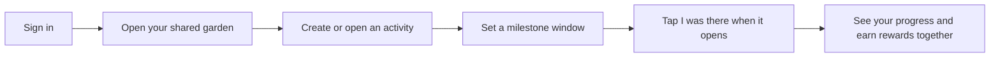
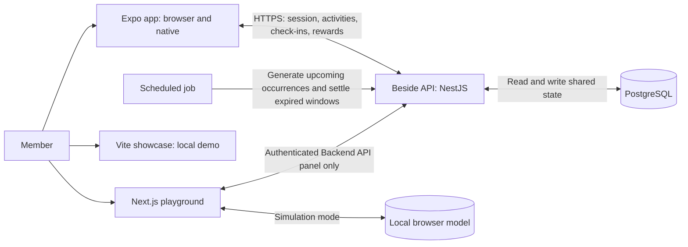
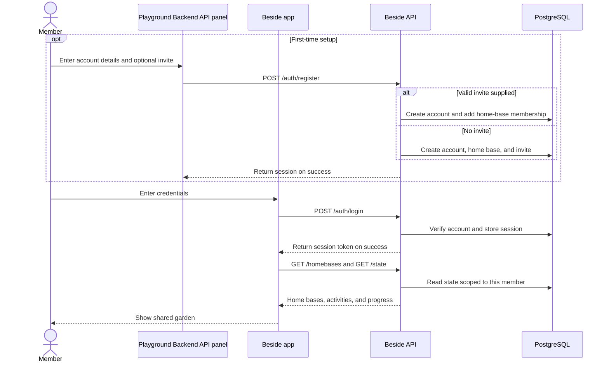
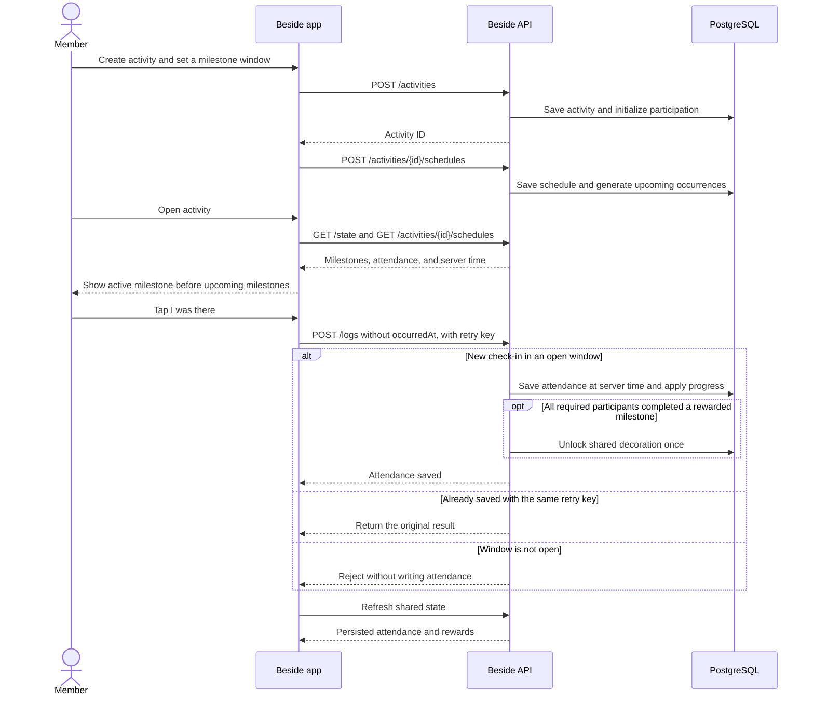
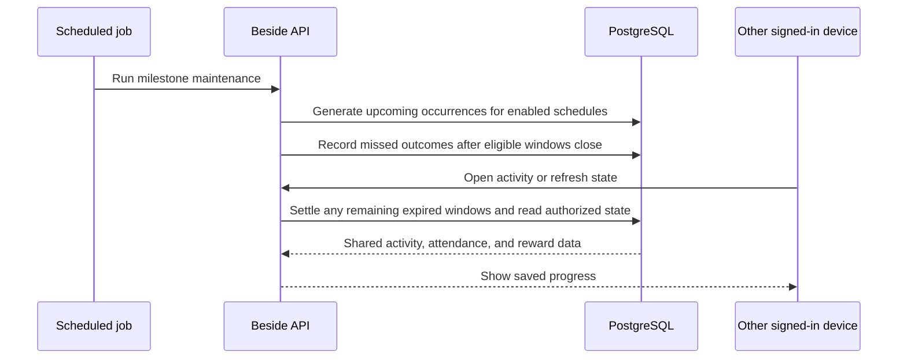

# Beside

**Do activities with friends and grow a shared pixel-art garden.** Create an
activity, set a time to check in, and earn decorations as the group makes
progress.

[Open the app in your browser](https://beside-mobile.vercel.app) · [Use cases and
system flows](#how-beside-works) · [Run locally](#getting-started)

## How Beside works



| I want to…                              | What happens                                                                                                                                                                 |
| --------------------------------------- | ---------------------------------------------------------------------------------------------------------------------------------------------------------------------------- |
| Start or join a shared garden           | Register through the playground’s **Backend API** panel or the API. An invite code joins an existing home base; otherwise a new one is created. Then sign in to the app.     |
| Plan something to do together           | Create an activity such as **Read together**. Set a milestone window once or repeat it on a schedule.                                                                        |
| Check in                                | Open the activity, find the named active milestone at the top, and tap **I was there**. **Attendance recorded** confirms it was saved.                                       |
| See the group's progress                | Open the same activity from another device or refresh it. The clients read the same home-base data; no live sync is required.                                                |
| Earn a decoration                       | When all participants required for a reward complete its milestone, the shared garden earns the item once.                                                                   |
| Experiment without changing shared data | Use the showcase to explore the concept or the playground's local model. The playground's **Backend API** panel is separate and does change the API data it is connected to. |

<details>
<summary>System map: which apps share data?</summary>



The Expo app is one React Native project with a web build. The showcase is
not the browser version of the signed-in app. See the [API
guide](apps/api/README.md) and the [playground guide](apps/playground/README.md).

</details>

<details>
<summary>Sequence: sign in or join a home base</summary>



</details>

<details>
<summary>Sequence: plan an activity, check in, and earn a reward</summary>



The API also generates recurring windows ahead of time and settles missed
windows. See [scheduling and missed deadlines](apps/api/README.md#recurring-milestones-and-missed-deadlines).
For direct API clients, omit `occurredAt` to record an immediate check-in at
server time. Explicit timestamps are still accepted for past events; they do
not override the milestone's server-side submission window.

</details>

<details>
<summary>Sequence: recurring windows and progress on another device</summary>



No device needs to be online when the scheduled job runs. Devices read the
shared state when they open or refresh; this is not a live push feed.

</details>

See [CI and automatic deployments](.github/README.md) for the GitHub Actions setup
and [project documentation](docs/README.md) for the working concept, design
storyboard, and mobile UI concept.

New to the project? Start with the [contributing guide](CONTRIBUTING.md) for local setup, development workflows, and pull request checks.

## Apps and packages

- `apps/api` (`@beside/api`): the shared NestJS/PostgreSQL backend, with authentication, milestone/reward transactions, and served OpenAPI docs. See [API setup](apps/api/README.md).
- `packages/domain`: model types, validation, templates, and commands shared by the API and local playground.
- `packages/api-client`: typed fetch client for mobile and web.

- `apps/website` (`beside-showcase`): the original Vite/React showcase website, with its six interactive chapters, pixel-art world, and project notes.
- `apps/mobile` (`mobile`): the Ignite/React Native app.
- `apps/playground` (`playground`): the Next.js model workbench with local persistence and Mermaid ERDs.
- `packages/rewards`: reward catalog types and pixel art shared by mobile and playground.
- `packages/eslint-config`: shared ESLint configuration.
- `packages/typescript-config`: shared TypeScript configuration.

## Getting started

Use Node.js 24 or newer and the pnpm version specified in `package.json`.

```sh
pnpm install
pnpm dev --filter=beside-showcase
pnpm dev --filter=mobile
pnpm dev --filter=playground
```

To run the mobile app in a browser without a simulator, use these commands from the repository root:

```sh
pnpm install
pnpm --filter mobile web
```

Open the URL Expo prints. Use `/world` for the pixel world or `/rewards` for reward items.

The website runs at `http://127.0.0.1:5173`. See [the website README](apps/website/README.md) for its controls and demos. See [the mobile README](apps/mobile/README.md) for Ignite, simulators, and workspace scripts.

Playground runs at `http://localhost:3002`. See [its README](apps/playground/README.md) for experiments, ownership assumptions, trigger simulations, and import/export.

## Build

```sh
pnpm build --filter=beside-showcase
pnpm --filter beside-showcase preview
```

The website's production output is `apps/website/dist`. Run `pnpm build`, `pnpm lint`, or `pnpm check-types` to execute the corresponding available scripts across the workspace.

The website retains its original JavaScript source and Vite scripts; it does not currently define lint or type-check tasks.
