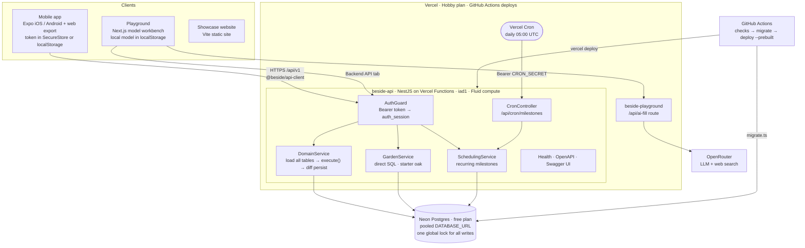

# Current architecture (as-is)

Scanned from `main` at `9dabc6d` (2026-11-14, after PR #16). This page
describes what runs today. The target is in
[`target-architecture.md`](target-architecture.md), and the request paths are
in [`data-flows.md`](data-flows.md).

## Components

| Component        | Where                                                        | Notes                                                                                                                     |
| ---------------- | ------------------------------------------------------------ | ------------------------------------------------------------------------------------------------------------------------- |
| Mobile app       | `apps/mobile` (Ignite / Expo)                                | Native builds plus a web export deployed to Vercel; session token in `expo-secure-store` (native) or `localStorage` (web) |
| Playground       | `apps/playground` (Next.js)                                  | Local model workbench in `localStorage`; Backend API tab calls the real API; `/api/ai-fill` calls OpenRouter              |
| Showcase website | `apps/website` (Vite)                                        | Static; separate deployment                                                                                               |
| API              | `apps/api` (NestJS 11)                                       | `https://beside-api.vercel.app`; `iad1`; Fluid compute; pool of 5 connections per instance                                |
| Shared code      | `packages/domain`, `packages/api-client`, `packages/rewards` | Domain rules run inside the API; the typed client is shared by mobile and playground                                      |
| Database         | Neon Postgres (free) via Vercel Marketplace                  | Migrations `001`–`005` in `apps/api/src/db/migrations`                                                                    |
| Scheduled work   | Vercel Cron, daily at 05:00 UTC                              | Generates recurring milestones and records missed deadlines                                                               |
| CI/CD            | `.github/workflows/ci-and-deploy.yml`                        | Type checks and tests against PostgreSQL 17; on `main`, migrate production, then deploy prebuilt artifacts                |

## API surface

| Area            | Routes                                                                                                                             |
| --------------- | ---------------------------------------------------------------------------------------------------------------------------------- |
| Health and docs | `GET /health`, `GET /health/ready`, `/docs`, `/openapi.json`                                                                       |
| Auth            | `POST /api/v1/auth/register`, `login`, `logout`; `GET /api/v1/auth/me`                                                             |
| Read            | `GET /api/v1/state`, `homebases`, `templates`, `catalog`, `subjects`, `activities`, `milestones`, `logs`, `rewards`, `events`      |
| Write           | `POST` `homebases`, `homebases/join`, `subjects`, `activities`, `activities/:id/subjects`, `milestones`, `logs`, `logs/:id/shares` |
| Manage          | `PATCH` / `DELETE` on `homebases/:id`, `activities/:id`, `milestones/:id`; `PATCH activities/:id/participation`                    |
| Garden          | `GET homebases/:id/garden`, `POST homebases/:id/garden/starter-oak`                                                                |
| Schedules       | `GET` / `POST activities/:id/schedules`, `DELETE schedules/:id`                                                                    |
| Cron            | `GET /api/cron/milestones` (Vercel Cron only, `CRON_SECRET`)                                                                       |

## Known limits today

- Every write takes the same advisory lock (`724390821`), so writes are serialized across all users.
- Most requests load every table (`loadDatabase`) and diff the whole snapshot on save.
- `GET /state` opens a write transaction to settle expired milestones, so reads also wait for the lock.
- Hobby plan: non-commercial use only, one function region, cron once per day.
- Neon free plan in the US; there is no Canadian Neon region.
