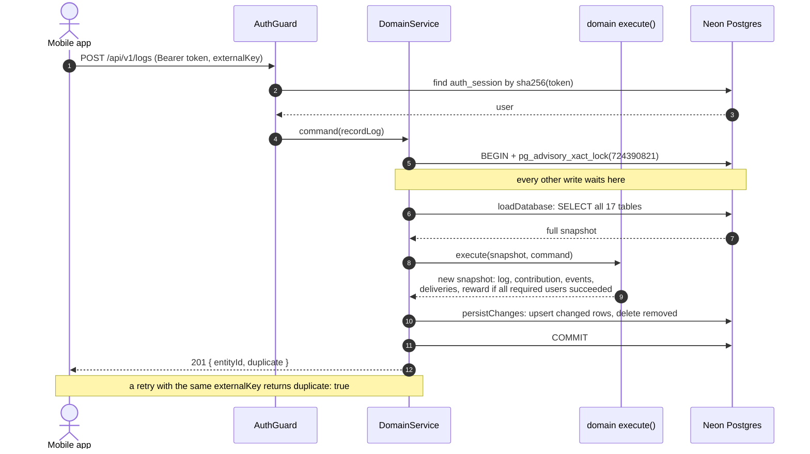
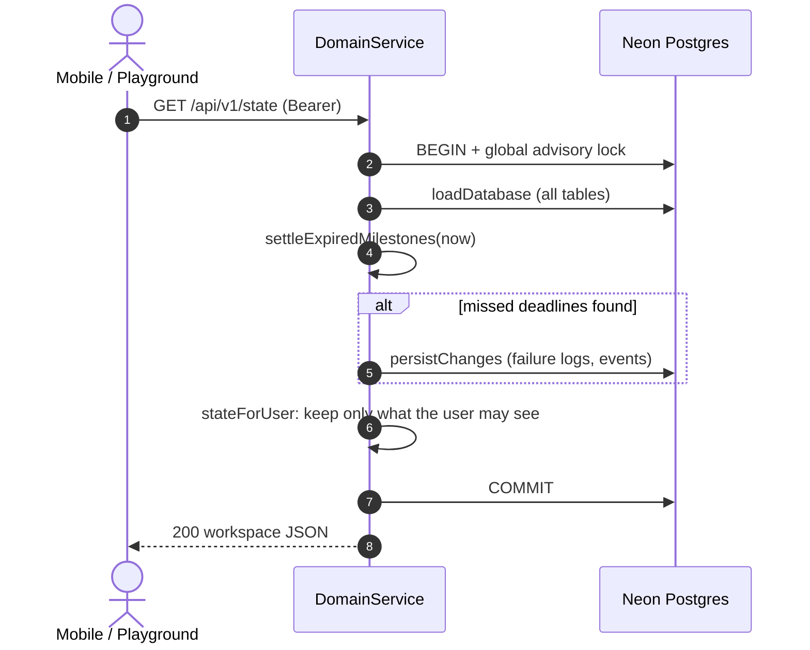
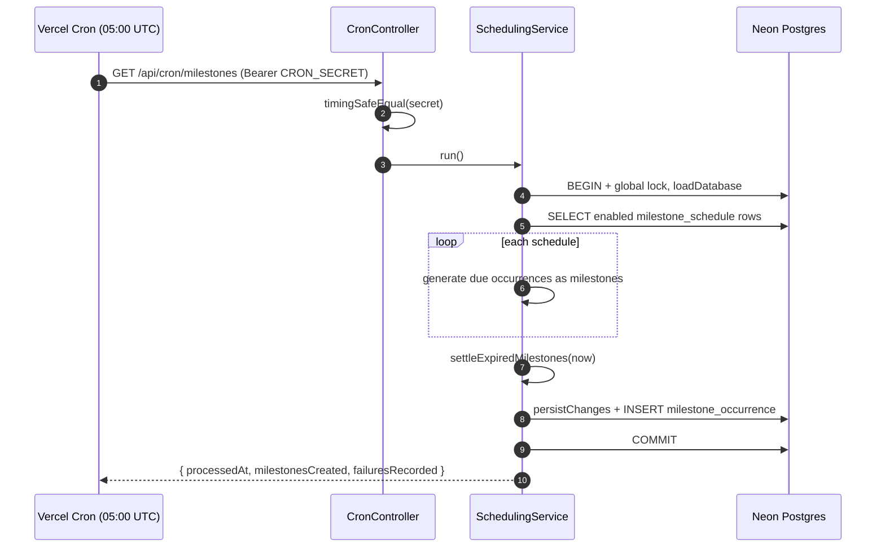
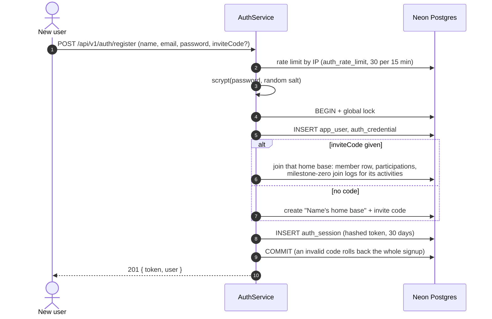
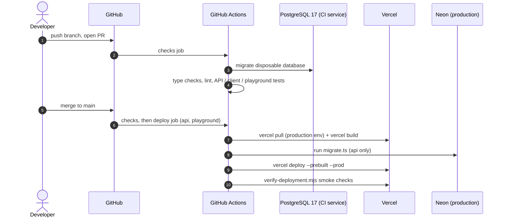

# Data flows (as-is)

How requests move through the system today, traced from the code on `main`
(`9dabc6d`). Component overview: [`current-architecture.md`](current-architecture.md).

## 1. Write a command (example: record a log)

Every write runs as one transaction behind a single global lock and works on an
in-memory copy of the whole database.

## 2. Read the workspace (`GET /api/v1/state`)

Reads also take the write lock, because they settle expired milestones before
answering.

## 3. Daily cron (recurring milestones and missed deadlines)

## 4. Sign up and join a home base

## 5. Deploy

