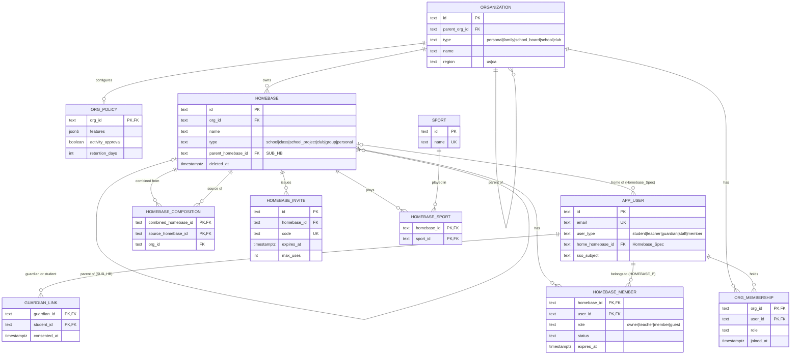
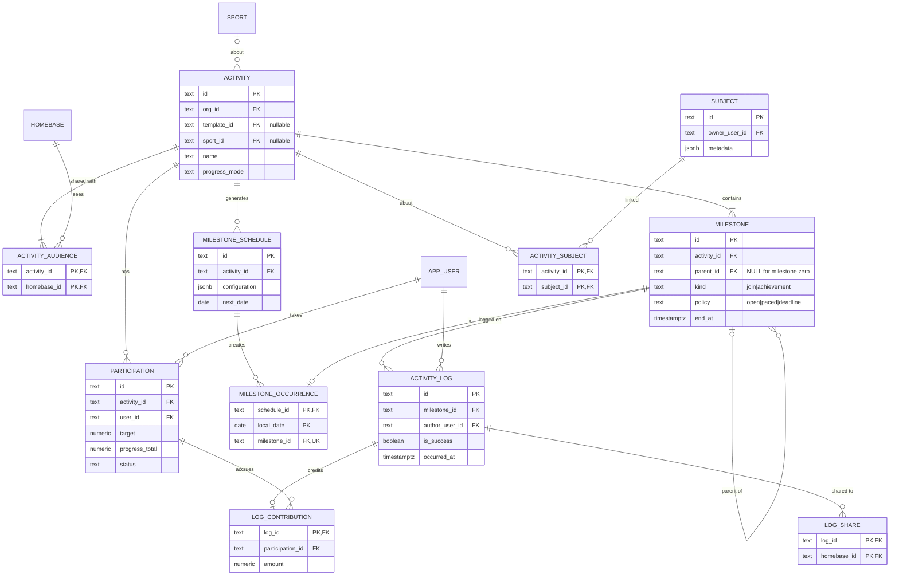
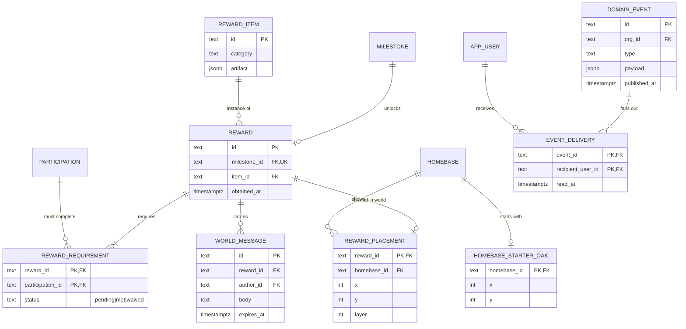

# Beside target data model (ERD)

Source of truth: [`target-schema.sql`](target-schema.sql). These diagrams render natively on GitHub.
Example data from the whiteboard: [`seed-whiteboard-example.sql`](seed-whiteboard-example.sql).

## Whiteboard mapping (2026-11-14)

| Whiteboard                               | Schema                                                                                               |
| ---------------------------------------- | ---------------------------------------------------------------------------------------------------- |
| `USER_ID`                                | `app_user.id`                                                                                        |
| `USR_TYPE` (Teacher, Student)            | `app_user.user_type`; per-place permissions stay in `org_membership.role` and `homebase_member.role` |
| `HOMEBASE_P` list `[3A, 3B, 3A+3B]`      | one `homebase_member` row per homebase (no arrays, so each has an FK, role and dates)                |
| `Homebase_Spec` (4A / NULL)              | `app_user.home_homebase_id` (nullable FK)                                                            |
| Homebase `HB_ID`                         | `homebase.id`                                                                                        |
| Homebase `TYPE` (School, Sch_Prj, Class) | `homebase.type` in `school`, `school_project`, `class`, `club`, `group`, `personal`                  |
| `SUB_HB` + self arrow, N-ary tree        | `homebase.parent_homebase_id` (one parent, many children; cycles rejected by trigger)                |
| Combined homebase `3A+3B`                | `homebase` of type `school_project` + `homebase_composition` rows to 3A and 3B                       |
| `Sport` (Futbol)                         | `sport`                                                                                              |
| `MAP_sport_Homebase`                     | `homebase_sport`                                                                                     |

## 1. Tenancy, people and homebases

## 2. Activities, milestones and logs

## 3. Rewards, world and events

Not drawn: `category`, `subject_template`, `activity_template`, `auth_credential`, `auth_session` (see the SQL).
