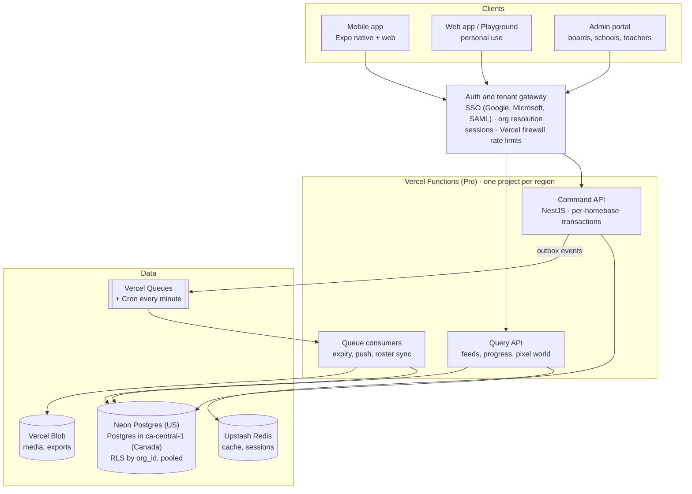
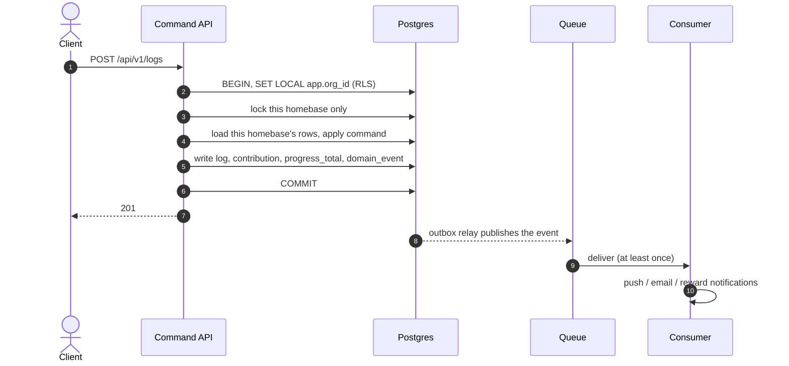
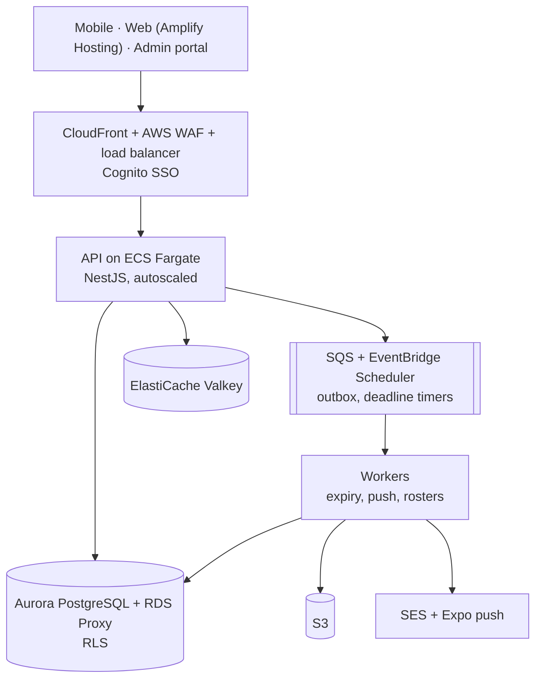

# Target architecture

Where the system is heading. Today's system is in
[`current-architecture.md`](current-architecture.md); the data model is in
[`schema/ERD.md`](schema/ERD.md); the PR-by-PR plan is in
[`schema/IMPLEMENTATION-PLAN.md`](schema/IMPLEMENTATION-PLAN.md).

## Recommended: stay on Vercel (Pro)

Each region (US `iad1` + Neon; Canada `yul1` + Postgres in AWS `ca-central-1`)
runs its own copy. `organization.region` decides which stack a tenant uses.

### Target write flow

## Alternative: AWS

Same stack in `ca-central-1` and `us-east-1`. Everything, including Postgres,
can stay in Canada, at the cost of more operations work than Vercel.
