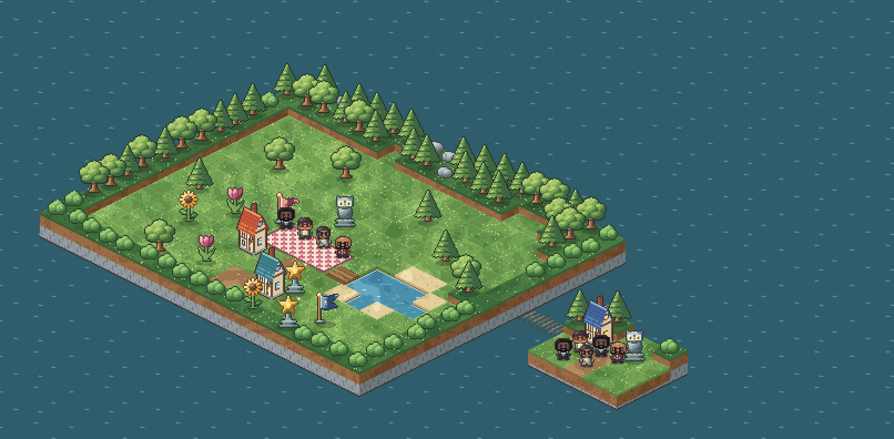
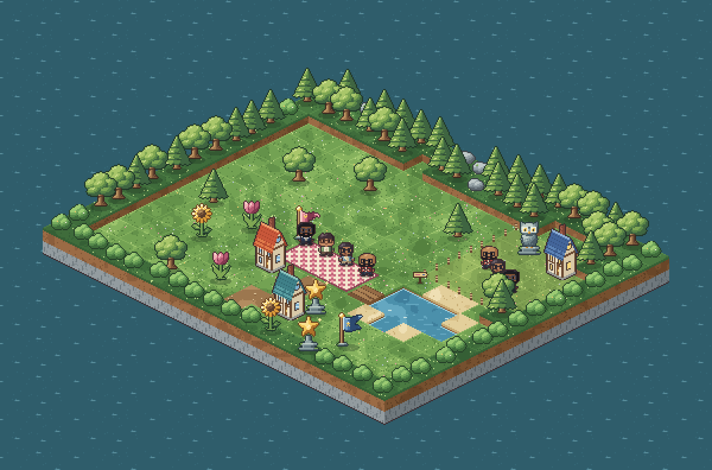
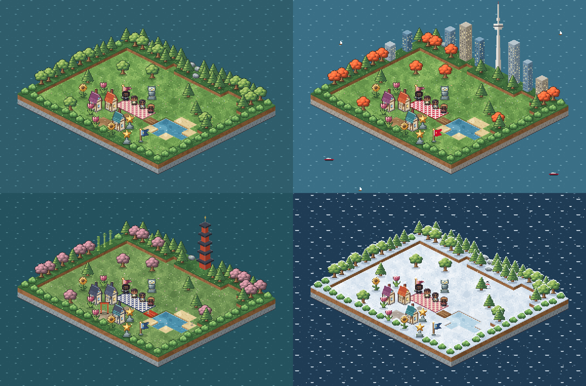

# Joint activities on the island — assessment

> **For discussion, not to merge.** Business ask: *"split the island for a joint activity."* This note assesses the
> impact on the current schema (main @ `ba0b378`) and shows how it could render on the isometric island from #19.
> Related: #19 (isometric island), #20, #29 (archipelago), #30 (custom island shapes).

"Joint activity" is read here as **one activity shared by two or more home bases** — e.g. the *Cousins* family and
*Ms. Chen's Grade 5*.

## Two ways to show it

| Shared islet + bridge (recommended) | Fenced shared zone on the island |
|---|---|
|  |  |

**Islet.** Each participating island gets a small islet offshore, joined by a plank bridge, with a signpost at the
bridge foot. The cottage uses the activity's roof colour and lights up while a milestone window is open. The other
group's avatars appear **only on the islet**, never on your own island. Tapping it opens the activity screen — the
islet *is* the existing `buildActivityScene` vignette, unchanged, with attendees from both groups.
Doesn't cost island space, several joint activities = several islets, planting rules untouched. Pairs naturally
with #29 (islands with water between them) and #30 (islands that can grow).

**Zone.** A fenced plot on each island, content mirrored on both. Tight even with one joint activity (it displaced
trees and the owl), no room for a second, the starter-oak placement check would need to become zone-aware, and
other people's children appear on your family's island.

## What the current schema assumes

| Area | Today | Breaks for a joint activity |
|---|---|---|
| `activity.connection_id` | `NOT NULL`, one home base | An activity can't belong to two |
| Visibility (`model.ts`: `members()`, activity listing) | Member of the activity's one home base | Guests can't see or log to it |
| `reward.homebase_id` + `required_user_ids` | One owner, roster snapshot | Who owns it; roster spans groups |
| `event_delivery.connection_id` | Fan-out to one home base | Updates must reach every group |
| `homebase_invite` | Joins a whole home base | No "invite a home base to an activity" |
| `deleteHomebase` | Deletes its activities | Host deleting would wipe guests' activity |
| `log_share` | Already one log → many home bases | ✅ reusable as is |

## Minimal schema changes

1. **`activity_homebase`** (`activity_id`, `homebase_id`, `role` host/guest, `status` invited/accepted/left,
   `joined_at`). Keep `activity.connection_id` as the host for backward compatibility.
2. **Membership checks** become the union of linked home bases (visibility, logging, delivery fan-out) — the
   largest code change, mostly in `packages/domain/src/model.ts`.
3. **Rewards:** a completed joint milestone mints **one `reward` row per participating home base** (optional
   `source_activity_id`). No reward-table redesign, and "only achievements earn items" still holds.
4. **Islet placement:** `homebase_joint_slot` (`homebase_id`, `activity_id`, `slot`) — fixed slots around the
   island, same idea as `HOUSE_LOTS`.
5. **Tenancy:** if home bases sit in different tenants (school board vs personal), tenant-scoped row security needs
   an explicit rule for these rows. Start with **same-tenant only**.

## UI impact

- Home island: islet(s) offshore with bridge + signpost; camera frame/recenter must include the islet slots.
- Activity screen: "Cousins + Grade 5" chip; attendees from both groups in the vignette.
- Activity list: "Joint" badge. Invite flow: host invites another home base; its guardian/teacher accepts.

## Risks / decisions for the business

- **Child privacy & consent** (ages 8–15): guests see another group's names and avatars → guardian/teacher
  approval when accepting, first names only.
- **Ownership:** host leaves or deletes their home base; a guest group leaves mid-activity.
- **Avatars:** only four art styles today, so a second group looks like the first — more variety needed.
- **Timing:** rough 1.5–3 weeks (schema + domain 3–5 d, islet UI 3–4 d, invites/consent 3–5 d). Not before the
  Nov 25 freeze for Dec 2 testing; show as a concept at the Dec 16 demo.

## Theme explorations (same renderer)

City/season looks on the #19 island, done by palette + landmark overrides only:

Individual renders: [default](images/iso-default.png) · [Toronto](images/iso-toronto.png) ·
[Kyoto](images/iso-kyoto.png) · [winter](images/iso-winter.png). How to re-render: [render/README.md](render/README.md).
